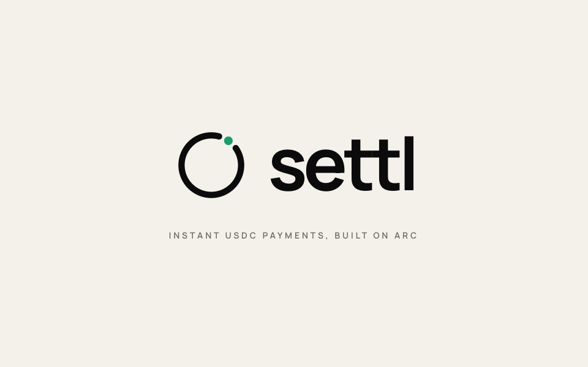

<p align="center">
  
</p>

> **TESTNET ONLY. No real funds are used or at risk. The contract is unaudited.**

Settl is a non-custodial USDC point-of-sale PWA for Arc Testnet. A merchant types an amount and gets a QR code. The customer scans, connects any EVM wallet, and pays in one or two taps. Arc's sub-second finality means the merchant screen flips green within 1–3 seconds of the transaction landing.

Built with [Arc Studio](https://studio.arc.io)

---

## Quick Start

```bash
git clone https://github.com/uwaifo18/settl
cd settl
bun install
cp .env.example .env          # fill in VITE_PRIVY_APP_ID and VITE_ROUTER_ADDRESS
bun run dev                   # http://localhost:5173
```

**Run contract tests:**
```bash
forge test --gas-report
```

**Production build:**
```bash
bun run build
```

---

## Architecture

```
Browser (merchant)              Browser (customer)
   MerchantApp                      PayPage
        |                               |
  localStorage                  URL hash fragment
  (settings,                    (invoice params —
   IndexedDB history)            never hits a server)
        |                               |
   watcher.ts                   Privy (wallet connect)
  (viem WS/HTTP)                       |
        |                     Memo.memo(router, pay(...))
        +------>  SettlRouter  <--------+
                 (Arc Testnet)
                      |
               USDC.safeTransferFrom
               (funds go directly to merchant)
```

**Payment flow:**
1. Merchant enters amount → `createInvoice()` → QR / NFC tag with pay URL (hash fragment only)
2. Customer scans QR → `/pay` decodes + validates invoice → approve USDC → pay via Memo wrapper
3. Merchant watcher subscribes to `Paid(invoiceId, merchant, payer, amount)` via WebSocket + 2s HTTP poll fallback
4. On matching event: verify `isPaid()` onchain → PAID screen + chime + haptic

No backend. No custody. No merchant keys.

---

## Getting Testnet USDC and Adding Arc Testnet

**In Arc Studio:** click **Get test USDC** in the sidebar.  
**In your wallet (MetaMask / Rabby):** add Arc Testnet manually:

| Field | Value |
|-------|-------|
| Network Name | Arc Testnet |
| RPC URL | `https://rpc.testnet.arc.io` |
| Chain ID | `5042002` |
| Currency Symbol | `USDC` |
| Block Explorer | `https://explorer.testnet.arc.io` |

---

## Contract

**SettlRouter** — non-custodial USDC payment router. No owner, no admin, no fees, no pause, no upgradeability.

| Property | Value |
|----------|-------|
| Contract name | `SettlRouter` (deployed as `ArcTapRouter` — bytecode identical) |
| Network | Arc Testnet (chain ID 5042002) |
| Address | `0x6216af3fb64d039b87088f78da38bd641d62b426` |
| Deploy tx | `0x1a4b8808443627f397f113970c1b034e96f6591456247834b26e836b7ee870cb` |
| Explorer | https://explorer.testnet.arc.io/address/0x6216af3fb64d039b87088f78da38bd641d62b426 |
| Verification | Not verified on explorer. Compiler settings in `foundry.toml` (`solc 0.8.24`, `optimizer: true, runs: 200`). Source: `contracts/SettlRouter.sol`. |
| USDC | `0x3600000000000000000000000000000000000000` (6 decimals) |

**Gas cost table (USDC, approximate):**

| Operation | Approx. gas | Approx. cost |
|-----------|-------------|--------------|
| `approve` | ~46,000 | < $0.001 |
| `router.pay()` | ~65,000 | < $0.001 |
| `approve + pay` total | ~111,000 | < $0.001 |

Arc gas is denominated in USDC (USDC is the native gas token). Fees are sub-cent by design.

### Deploy your own copy

```bash
forge build

# Import a deployer key into Foundry keystore (never use --private-key flag)
cast wallet import deployer --interactive

# Deploy SettlRouter
forge create contracts/SettlRouter.sol:SettlRouter \
  --rpc-url https://rpc.testnet.arc.io \
  --account deployer \
  --constructor-args 0x3600000000000000000000000000000000000000 \
  --broadcast

# Update deployments/arc-testnet.json and VITE_ROUTER_ADDRESS
```

---

## Phase 0 Recon Findings (condensed)

Full findings: [`recon/FINDINGS.md`](recon/FINDINGS.md)

| Question | Finding |
|----------|---------|
| `arcTestnet` in viem/chains? | Yes — built-in |
| USDC standard ERC-20 (6 decimals)? | Yes |
| EIP-2612 permit? | Not verified — sequential approve+pay used |
| EIP-3009 transferWithAuthorization? | Not verified — future work |
| WebSocket `eth_subscribe` logs? | Yes — `wss://rpc.testnet.arc.io` |
| Block time / finality | Sub-second, single-block finality |
| EIP-5792 batching | Not implemented — future work |

---

## Security Checklist

| Item | How it is met |
|------|--------------|
| Router address allow-listed | `VITE_ROUTER_ADDRESS` baked in at build time; URL `r=` param validated against it; mismatches rejected before any UI renders |
| All URL params validated | version, chain ID, address format, amount > 0, 32-byte invoice ID, deadline in future, name ≤ 32, memo ≤ 64 chars |
| No infinite approvals | Exact-amount approve only; skipped when allowance already sufficient |
| Chain ID checked before write | `useAccount().chainId` checked; `switchChain` called if wrong |
| PAID only after onchain verification | `verifyPaidLog()` checks contract address, invoiceId, merchant, amount ≥ requested, removed==false; followed by `isPaid()` read |
| No dangerouslySetInnerHTML | Zero occurrences in src/ |
| No keys client-side | Merchant app stores only a receiving address; no signing keys |
| Invoice IDs cryptographically random | `crypto.getRandomValues(32 bytes)` |
| No analytics | No analytics SDK |
| Security headers | CSP, Referrer-Policy, X-Content-Type-Options, X-Frame-Options, Permissions-Policy, HSTS in `vercel.json` |

---

## NFC

NFC write lets the merchant write the pay URL to an NFC tag so customers can tap to open the payment page.

**This is NOT contactless tap-to-pay.** It does not initiate a blockchain transaction from the tap. It only opens the payment URL in the customer's browser.

- Android Chrome only (`NDEFReader` API)
- Not available on iOS (WebNFC not supported in Safari)
- Requires a blank NFC tag (NTAG213 or similar)
- NFC UI is hidden automatically when `NDEFReader` is not available

---

## Testing

### Contract tests (Foundry)

```bash
forge test -vv
# 12 tests: happy path, event args, balance delta, expired deadline,
# double pay, zero amount, zero merchant, insufficient allowance,
# insufficient balance, merchant independence, router-zero-balance, fuzz
```

```bash
forge test --gas-report
```

### Frontend checks

```bash
bun run check      # typecheck + lint (0 errors, 0 warnings)
bun run build      # production build
```

---

## Simulator

`scripts/simulate-customer.ts` simulates a customer paying a Settl invoice from the CLI.

```bash
# Pay a link at the exact invoice amount
CUSTOMER_PRIVATE_KEY=0x... bun run scripts/simulate-customer.ts \
  "https://settl-sable.vercel.app/pay#v=1&r=0x6216...&..."

# Simulate underpay (amount-override < invoice amount — will be rejected by watcher)
CUSTOMER_PRIVATE_KEY=0x... bun run scripts/simulate-customer.ts \
  "<link>" --amount-override 100000

# Simulate overpay
CUSTOMER_PRIVATE_KEY=0x... bun run scripts/simulate-customer.ts \
  "<link>" --amount-override 9999999
```

The simulator:
- Refuses any chain other than Arc Testnet (chain ID 5042002)
- Reads the private key from env only, never from args
- Reuses the app's own link parser (`decodeInvoiceHash`) logic
- Prints the tx hash and elapsed time to confirmation

---

## Deployment

The app is deployed to Vercel from the `main` branch of `uwaifo18/settl`.

Push to `main` → Vercel auto-deploys. The contract address is baked in at build time via `VITE_ROUTER_ADDRESS`.

---

## Environment Variables

| Variable | Required | Description |
|----------|----------|-------------|
| `VITE_ROUTER_ADDRESS` | Yes | Deployed SettlRouter address |
| `VITE_PRIVY_APP_ID` | Yes | Privy app ID (wallet connection on pay page) |
| `VITE_CLIENT_KEY` | No | Circle Modular Wallets client key (passkey wallet for merchants) |
| `VITE_CLIENT_URL` | No | Circle Modular Wallets endpoint (default: `https://modular-sdk.circle.com/v1/rpc/w3s/buidl`) |
| `VITE_WALLETCONNECT_PROJECT_ID` | No | WalletConnect project ID |
| `RPC_PROXY_BASE_URL` | No | Arc Studio RPC proxy (injected automatically inside Arc Studio) |
| `RPC_PROXY_TOKEN` | No | Arc Studio RPC proxy token (injected automatically inside Arc Studio) |
| `RPC_PROXY_CHAINS` | No | Arc Studio RPC proxy chain list (injected automatically inside Arc Studio) |

---

## Troubleshooting

**Wallet cannot switch to Arc Testnet**  
Add the network manually in your wallet (see "Getting Testnet USDC" above). MetaMask and Rabby support custom networks. Rabby on mobile may hang on the transaction screen for unknown chains until the network is added.

**QR code will not scan**  
Ensure the merchant screen is at maximum brightness. The QR is always rendered dark-on-white. Try increasing the charge screen font size by zooming out. If the customer's camera app doesn't open the URL, copy-paste the link manually.

**Watcher shows offline / PAID never appears**  
Check network connectivity. The watcher reconnects automatically on `online` and `visibilitychange` events. If the merchant tab was backgrounded, bringing it to the foreground triggers a backfill. The watcher polls every 2 seconds as a fallback even when WebSocket is active.

**NFC permission denied**  
NFC requires a user gesture (tap) to initiate on Android. The app requests permission on first use — if denied, go to Android Settings → Apps → Chrome → Permissions → NFC and enable it.

**iOS install steps (Add to Home Screen)**  
1. Open `settl-sable.vercel.app` in Safari
2. Tap the Share button (square with arrow)
3. Scroll down and tap **Add to Home Screen**
4. The app opens in standalone mode with no browser chrome

**"Invalid router address in link"**  
The QR was generated before `VITE_ROUTER_ADDRESS` was set in the build. Regenerate the invoice from the updated build.

**Privy modal does not open**  
Ensure `VITE_PRIVY_APP_ID` is set in Vercel's environment variables AND your deployment domain is in the Privy Console → your app → Settings → Allowed domains.

---

## Future Work

- EIP-3009 single-signature payment (`payWithAuthorization`) — eliminates one wallet confirmation
- EIP-5792 batch approve+pay — one confirmation for both steps
- `simulateContract` pre-flight to surface revert reasons before wallet prompts
- Smart contract wallet support in Memo path (detect EOA vs SCA, fall back to direct `router.pay()`)
- Estimated gas fee display on the pay page
- Fork test against live Arc Testnet USDC
- Coverage report (target > 95%)
- Mainnet deployment (requires independent security audit)

---

## License

MIT — see [LICENSE](LICENSE)
