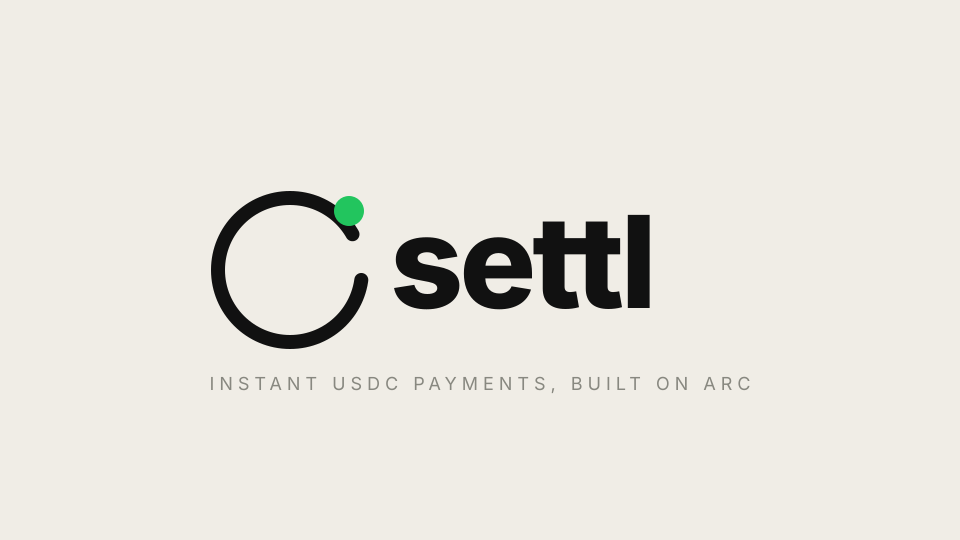

<p align="center">
  
</p>

<h1 align="center">Settl</h1>
<p align="center"><strong>A USDC point of sale for merchants. Type an amount, show a code, get paid.</strong></p>

<p align="center">
  <a href="https://settl-sable.vercel.app">Live demo</a> ·
  <a href="https://settl-sable.vercel.app/app">Open the app</a> ·
  <a href="https://x.com/aisuskii">@aisuskii on X</a>
</p>

---

> **SettlRouter is verified on Arc Scan.** The contract is minimal, immutable, and has no owner, no admin key, and no upgrade path. Source code is publicly readable at the addresses below.

---

## What is Settl?

Settl is a non-custodial USDC point-of-sale progressive web app built on **Arc** — a blockchain where USDC is the native gas token. It is designed for merchants who want to accept crypto payments without a terminal, a backend, or an intermediary.

**The full flow in three steps:**

1. The merchant types an amount on the keypad. Settl generates a QR code (or writes an NFC tag on supported Android devices).
2. The customer scans the QR, sees the merchant name and exact amount in their wallet, and approves the payment.
3. The merchant's screen turns green — usually within one second of the transaction landing on-chain.

No accounts. No custody. No backend. No gas token other than USDC. Funds go straight from the customer's wallet to the merchant's wallet address.

---

## Why this is different

Most crypto payment tools have one of two problems: they are custodial (the provider holds the funds), or they are slow (multiple block confirmations, unpredictable fees). Settl has neither.

| Property | Settl | Most crypto POS tools |
|---|---|---|
| Custody | Non-custodial — funds go direct to merchant | Custodial — funds sit in a provider wallet |
| Gas token | USDC only — one balance, one token | Requires ETH / native token for gas |
| Settlement time | ~1 second (Arc finality) | 10 seconds to several minutes |
| Backend required | No | Usually yes |
| Merchant account | Not required — just a wallet address | Required |
| Fees | None (network gas only, sub-cent) | 1–3% |

Arc makes this possible. Because USDC is the native gas token on Arc, merchants and customers never need to hold a second token. Because Arc has sub-second finality, the PAID screen is not an optimistic estimate — it is an on-chain confirmation.

---

## How the payment is verified

Settl does not show PAID based on a pending transaction. Before the green screen appears, the app runs two independent checks:

1. **Parse the `Paid` event log from the transaction receipt.** The log must come from the correct SettlRouter contract address, with a matching invoice ID, the correct merchant address, and an amount that covers the invoice.
2. **Call `isPaid()` on the router contract.** The contract itself confirms the invoice has been settled.

Both must pass. If either fails, the payment is rejected. This means even if a customer crafts a payment transaction that emits a fake event, or tries to pay a different invoice on the same contract, Settl rejects it.

The invoice itself lives entirely in the URL hash fragment — it never touches a server. There is no account, no session, and no database. Cross-network replay is blocked: each invoice embeds the chain ID and router address it was created on, and the pay page rejects any mismatch before showing the wallet prompt.

---

## Architecture

```
Browser (merchant /app)             Browser (customer /pay)
        │                                     │
  localStorage                        URL hash fragment
  IndexedDB history                   (invoice — no server)
        │                                     │
   watcher.ts ──── WebSocket / HTTP ────── viem
  (event subscription                    │
   + getLogs backfill)           simulateContract (pre-flight)
        │                                     │
        └──────────── SettlRouter ────────────┘
                    (Arc Testnet or Mainnet)
                            │
                   USDC.safeTransferFrom
                   (direct to merchant)
```

**Key design choices:**

- **No backend.** The invoice is encoded in the URL hash fragment (never sent to a server). The pay page decodes it client-side using the same parameters the merchant's app encoded.
- **No custody.** `safeTransferFrom` moves USDC from the customer to the merchant in one atomic step. The SettlRouter contract never holds funds.
- **Wallet providers scoped by route.** The landing page (`/`) imports zero wallet SDK code. Privy and wagmi are only loaded on `/app` and `/pay` — the landing chunk stays lean.
- **Resilient watcher.** The merchant watcher uses WebSocket subscription with a HTTP polling fallback. `getLogs` backfill uses paged 9,999-block chunks. Range-too-large RPC errors (`-32012`) are auto-halved recursively. Transient errors retry with exponential backoff. The watcher reconnects automatically on network restore and app foreground.

---

## SettlRouter contract

The contract is minimal by design: no owner, no admin key, no fees, no pause, no upgradeability.

```solidity
function pay(
    address merchant,
    uint256 amount,
    bytes32 invoiceId,
    uint64  deadline
) external
```

- `safeTransferFrom` moves funds directly from the customer (`msg.sender`) to the merchant in one step.
- The `Paid` event records the full payment details on-chain.
- `isPaid(invoiceId)` can be queried at any time to verify settlement.
- Double-pay is blocked: a paid invoice ID cannot be paid again.
- Expired invoices are rejected: `block.timestamp > deadline` reverts.

The router has zero state other than the `paid` mapping. It can never be upgraded, drained, or paused. There is no way for anyone — including the deployer — to access merchant funds through the contract.

### Deployments

| Network | Address | Explorer |
|---|---|---|
| Arc Testnet (5042002) | `0x6216af3fb64d039b87088f78da38bd641d62b426` | [View](https://explorer.testnet.arc.io/address/0x6216af3fb64d039b87088f78da38bd641d62b426) |
| Arc Mainnet (5042) | `0xaC6ae5A67Ded7804104008B7Ec0F46Dd3472038F` | [View](https://explorer.arc.io/address/0xaC6ae5A67Ded7804104008B7Ec0F46Dd3472038F) |

USDC address (both networks): `0x3600000000000000000000000000000000000000` (6 decimals)

Gas cost per payment (USDC, approximate):

| Operation | Gas | Cost |
|---|---|---|
| `approve` | ~46,000 | < $0.001 |
| `router.pay()` | ~65,000 | < $0.001 |
| Total per payment | ~111,000 | < $0.001 |

---

## Routes

| Path | Description |
|---|---|
| `/` | Marketing landing page — zero wallet code, fast load |
| `/app` | Merchant POS — keypad, QR/NFC, awaiting screen, history |
| `/pay` | Customer payment page — decodes invoice, connects wallet, pays |

Old pay links (`/pay#v=1&...`) continue to work without change.

An installed PWA that opens at `/` is redirected to `/app` automatically (standalone display mode detection).

---

## Quick start

```bash
git clone https://github.com/uwaifo18/settl
cd settl
bun install
cp .env.example .env
# Fill in VITE_NETWORK, VITE_PRIVY_APP_ID, and the router address for your target network
bun run dev        # http://localhost:5173
```

**Add Arc Testnet to your wallet:**

| Field | Value |
|---|---|
| Network name | Arc Testnet |
| RPC URL | `https://rpc.testnet.arc.io` |
| Chain ID | `5042002` |
| Currency symbol | `USDC` |
| Block explorer | `https://explorer.testnet.arc.io` |

Get free testnet USDC: click **Get test USDC** in the Arc Studio sidebar, or visit [faucet.circle.com](https://faucet.circle.com).

---

## Environment variables

Copy `.env.example` to `.env`. Never commit `.env`.

### Required for all builds

| Variable | Description |
|---|---|
| `VITE_NETWORK` | `testnet` (default) or `mainnet`. Any other value throws at startup. |
| `VITE_PRIVY_APP_ID` | Privy app ID — wallet connection on the pay page. |

### Testnet

| Variable | Description |
|---|---|
| `VITE_ROUTER_ADDRESS` | Deployed SettlRouter address on Arc Testnet. |

### Mainnet

| Variable | Required | Description |
|---|---|---|
| `VITE_MAINNET_ROUTER_ADDRESS` | Yes | SettlRouter address on Arc Mainnet. App shows a config error and disables payments if missing. |
| `VITE_ARC_MAINNET_RPC_URL` | No | Arc Mainnet HTTP RPC (default: `https://rpc.mainnet.arc.io`). |
| `VITE_ARC_MAINNET_WS_URL` | No | Arc Mainnet WebSocket RPC (default: `wss://rpc.mainnet.arc.io`). |
| `VITE_ARC_MAINNET_RPC_URL_FALLBACK` | No | Secondary HTTP RPC for the viem fallback transport. |
| `VITE_MAX_INVOICE_USDC` | No | Invoice cap in USDC (default: `50` on mainnet, `1000` on testnet). |
| `VITE_PASSKEY_MAINNET_ENABLED` | No | Set `true` to enable Circle passkey wallets on mainnet (disabled pending Circle mainnet endpoint verification — see DECISIONS.md D9). |

### Optional

| Variable | Description |
|---|---|
| `VITE_CLIENT_KEY` | Circle Modular Wallets client key (passkey wallets for merchants). |
| `VITE_CLIENT_URL` | Circle Modular Wallets endpoint. |
| `VITE_WALLETCONNECT_PROJECT_ID` | WalletConnect project ID. |
| `RPC_PROXY_BASE_URL` | Arc Studio RPC proxy (injected automatically in Arc Studio). |
| `RPC_PROXY_TOKEN` | Arc Studio RPC proxy token (injected automatically). |
| `RPC_PROXY_CHAINS` | Arc Studio proxy chain list (injected automatically). |

---

## Testing

### Contract tests (Foundry) — 24 tests

```bash
forge test -vv
forge test --gas-report
```

Covers: happy path, event args, balance delta, expired deadline, double-pay, zero amount, zero merchant, insufficient allowance, insufficient balance, merchant independence, zero-balance router, fuzz (100 runs).

### Frontend unit tests (Vitest) — 48 tests

```bash
bun run test
```

Covers: network config (`network.ts`), invoice encoding/decoding, watcher chunk sizing, range-error backoff, reconciliation logic, receipt verification, cross-network replay protection, clock-skew grace.

### Full check

```bash
bun run check      # lint + typecheck + unit tests, 0 errors 0 warnings
bun run build      # production build
```

---

## Deploy your own contract

```bash
forge build

# Import deployer key into Foundry keystore (never use --private-key flag)
cast wallet import deployer --interactive

# Testnet
forge create contracts/SettlRouter.sol:SettlRouter \
  --rpc-url https://rpc.testnet.arc.io \
  --account deployer \
  --constructor-args 0x3600000000000000000000000000000000000000 \
  --broadcast

# Mainnet — read docs/mainnet-deploy.md first
forge create contracts/SettlRouter.sol:SettlRouter \
  --rpc-url https://rpc.mainnet.arc.io \
  --account deployer \
  --constructor-args 0x3600000000000000000000000000000000000000 \
  --broadcast
```

After deployment, update `deployments/arc-testnet.json` (or `arc-mainnet.json`) and set the matching `VITE_ROUTER_ADDRESS` / `VITE_MAINNET_ROUTER_ADDRESS` in your Vercel environment variables.

---

## Security notes

| Item | How it is handled |
|---|---|
| Router address allow-listed | `VITE_ROUTER_ADDRESS` is baked in at build time. The `r=` param in the pay URL is validated against it on load — mismatches are rejected before any UI renders. |
| All URL params validated | Version, chain ID, address checksum, amount > 0, 32-byte invoice ID, deadline in future (with 30s clock-skew grace), name ≤ 32 chars, memo ≤ 64 chars. |
| No infinite approvals | Exact-amount approve only. Skipped if allowance is already sufficient. |
| Chain ID enforced | Checked before every write. `switchChain` is called automatically if the wallet is on the wrong network. |
| PAID requires two-factor on-chain verification | `verifyPaidLog()` validates the event log against the invoice; `isPaid()` reads the contract state. Both must pass. |
| No `dangerouslySetInnerHTML` | Zero occurrences in `src/`. |
| No keys stored client-side | Merchant app stores only a receiving address. No signing keys ever touch the app. |
| Cryptographically random invoice IDs | `crypto.getRandomValues(32 bytes)` — not sequential, not guessable. |
| No analytics | No tracking or analytics SDK of any kind. |
| Security headers | CSP, Referrer-Policy, X-Content-Type-Options, X-Frame-Options, Permissions-Policy, HSTS — all set in `vercel.json`. |
| Cross-network replay protection | Each invoice embeds chain ID and router address. A testnet QR cannot be paid on mainnet. |

---

## NFC

Settl can write the pay URL to an NFC tag so customers tap the tag to open the payment page — same result as scanning a QR code.

**This is not contactless card payment.** It does not initiate a transaction from the tap. It opens a URL in the customer's browser.

- Android Chrome only (Web NFC API — `NDEFReader`)
- Not available on iOS (Safari does not support Web NFC)
- Requires a blank NTAG213 or similar NFC tag
- NFC button is hidden automatically on unsupported devices

---

## PWA install

Settl is a full Progressive Web App. On iOS:

1. Open the app URL in Safari
2. Tap the Share button → **Add to Home Screen**
3. The app opens in standalone mode with no browser chrome

On Android Chrome, the browser shows an install banner automatically.

---

## Simulator

`scripts/simulate-customer.ts` simulates a customer paying a Settl invoice from the CLI — useful for testing the watcher and the PAID screen without a real wallet.

```bash
# Pay a live invoice at the exact amount
CUSTOMER_PRIVATE_KEY=0x... bun run scripts/simulate-customer.ts \
  "https://settl-sable.vercel.app/pay#v=1&r=0x6216...&..."

# Simulate underpay (rejected by the watcher — amount below invoice)
CUSTOMER_PRIVATE_KEY=0x... bun run scripts/simulate-customer.ts "<link>" --amount-override 100000

# Simulate overpay
CUSTOMER_PRIVATE_KEY=0x... bun run scripts/simulate-customer.ts "<link>" --amount-override 9999999
```

The simulator refuses any chain other than Arc Testnet. It reads the private key from the environment only — never from command-line arguments.

---

## Troubleshooting

**Wallet cannot switch to Arc**  
Add Arc Testnet or Arc Mainnet manually in your wallet (see Quick start above). MetaMask and Rabby support custom networks.

**QR code will not scan**  
Set the merchant screen to maximum brightness. The QR is always dark-on-white. If the camera app does not open the URL, copy the link manually.

**PAID screen never appears**  
Check connectivity. The watcher reconnects automatically on `online` and `visibilitychange`. Backgrounding the tab pauses the WebSocket on some browsers — bringing the tab back to the foreground triggers a backfill scan.

**NFC permission denied**  
NFC requires a user gesture on Android. If denied, go to Android Settings → Apps → Chrome → Permissions → NFC.

**"Invalid router address in link"**  
The QR was generated before `VITE_ROUTER_ADDRESS` was set correctly. Regenerate the invoice from the updated build.

**Privy modal does not open**  
Ensure `VITE_PRIVY_APP_ID` is set in Vercel environment variables and your deployment domain is in the Privy Console allowed domains list.

---

## Future work

- **StableFX / offramp** — after a payment lands, let the merchant convert USDC to local currency (USD, EUR, NGN, etc.) and withdraw to a bank account or mobile money wallet, directly from the history screen. No CEX required. Candidates: Circle Payouts API, Transak, MoonPay Business, Yellow Card (African markets).
- **EIP-3009 single-signature payment** (`payWithAuthorization`) — one wallet confirmation instead of two (approve + pay).
- **EIP-5792 batch** — `wallet_sendCalls` to combine approve and pay into a single user confirmation.
- **Smart contract wallet support** for merchant passkey wallets on mainnet (currently disabled pending Circle mainnet endpoint verification — see `DECISIONS.md` D9).
- **Fork tests** against live Arc Testnet and Mainnet USDC state.

---

## License

MIT — see [LICENSE](LICENSE)

---

Built with [Arc Studio](https://studio.arc.io)
